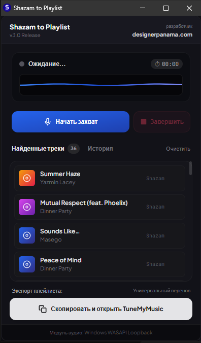

# Shazam to Playlist

[English](#english) | [Русский](#русский)


<p align="center">
  
  

</p>

---

## English

Background music recognizer for Windows. Built for capturing tracks from long podcasts, DJ sets, or streams via system audio (WASAPI Loopback) and exporting the entire tracklist to Spotify, YouTube Music, or Apple Music in one click.

### Download

**[Download Latest Release (v3.0 for Windows)](https://github.com/designerpanama/shazam-to-playlist/releases/latest)** — no Python installation required, just unzip and run `ShazamToPlaylist.exe`.

### Features

- **System Audio Capture:** Uses Windows WASAPI Loopback to listen directly to system sound without needing a microphone.
- **Session Control:** Start, pause, and resume recognition anytime during long 4+ hour streams or podcasts.
- **One-Click Playlist Export:** Copies all recognized tracks to the clipboard and opens **TuneMyMusic** for instant import into Spotify, YouTube, Apple Music, etc.
- **Search History:** Automatically saves recognized tracks in a separate tab so nothing gets lost.

### Run from Source

```bash
git clone [https://github.com/designerpanama/shazam-to-playlist.git](https://github.com/designerpanama/shazam-to-playlist.git)
cd shazam-to-playlist
pip install -r requirements.txt
python main.py
```

---

## Русский

Фоновый распознаватель музыки для Windows. Создан для того, чтобы слушать длинные подкасты, диджей-сеты или стримы, автоматически собирать все треки из системного звука (WASAPI Loopback) и в один клик переносить готовый плейлист в Spotify, YouTube Music или Apple Music.

### Скачать

**[Скачать последний релиз (v3.0 для Windows)](https://github.com/designerpanama/shazam-to-playlist/releases/latest)** — установка Python не требуется, просто распакуйте архив и запустите `ShazamToPlaylist.exe`.

### Возможности

- **Захват системного звука:** Использует Windows WASAPI Loopback — распознаёт музыку напрямую из системы без микрофона и посторонних шумов.
- **Управление сессией:** Распознавание можно поставить на паузу и продолжить в любой момент во время многочасовых подкастов.
- **Экспорт плейлиста в один клик:** Копирует список найденных треков в буфер обмена и открывает **TuneMyMusic** для быстрого импорта в Spotify, YouTube, Apple Music и другие сервисы.
- **История поиска:** Автоматически сохраняет все распознанные треки в отдельной вкладке.

### Запуск из исходного кода

```bash
git clone [https://github.com/designerpanama/shazam-to-playlist.git](https://github.com/designerpanama/shazam-to-playlist.git)
cd shazam-to-playlist
pip install -r requirements.txt
python main.py
```

---

Designed & built by **https://designerpanama.com**
